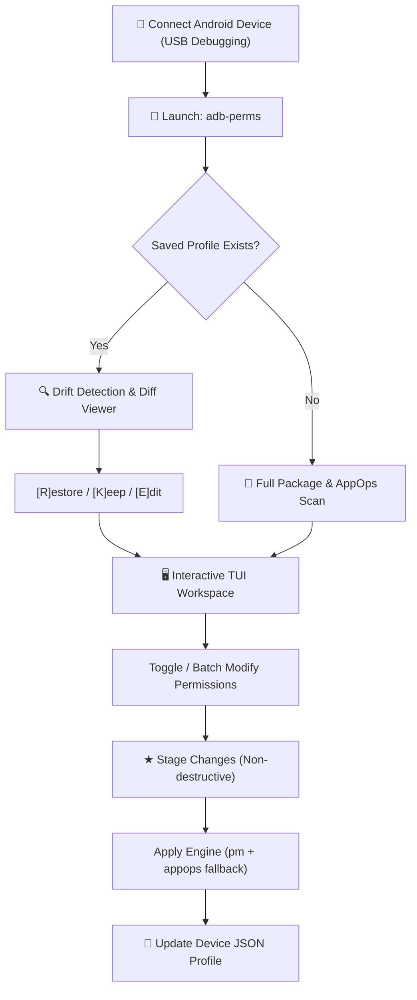

<div align="center">


# ADB Permission Manager

**A modern, keyboard-driven terminal console (TUI) for auditing, managing, batch-toggling, and profiling Android app permissions & AppOps via ADB — without root.**

[](LICENSE)
[](https://developer.android.com/tools/adb)
[](https://python.org)
[](https://github.com/Textualize/rich)
[](https://astral.sh/uv)
[](https://developer.android.com/studio/command-line/adb)

<p align="center">
  <a href="#key-features"><b>Key Features</b></a> •
  <a href="#ui--terminal-previews"><b>UI Previews</b></a> •
  <a href="#prerequisites--setup"><b>Setup</b></a> •
  <a href="#installation"><b>Installation</b></a> •
  <a href="#keyboard-shortcuts"><b>Shortcuts</b></a> •
  <a href="#profiles--drift-detection"><b>Profiles</b></a> •
  <a href="#architecture"><b>Architecture</b></a>
</p>

</div>

---

## Overview

Managing Android permissions through the standard device Settings app is notoriously cumbersome:
- **OEM fragmentation**: Stock Android, Samsung One UI, Xiaomi HyperOS/MIUI, and OnePlus OxygenOS all bury critical privacy toggles across different menus.
- **Hidden AppOps**: Advanced low-level operations (background clipboard access, notification listening, wake locks, run-in-background, OEM-specific ops) are completely invisible in the native UI.
- **No batch operations**: Revoking sensitive permissions like `CAMERA` or `ACCESS_FINE_LOCATION` across dozens of apps requires repetitive tapping.
- **No state persistence**: Setting up a new device or auditing permission creep after OS updates offers no backup, diffing, or version-control capabilities.

**ADB Permission Manager** solves this from the comfort of your terminal. It connects via standard Android Debug Bridge (ADB), performs a comprehensive scan of all installed packages (both user and system), gives you granular control over runtime permissions and AppOps, and persists device states into human-readable JSON profiles with automated drift detection.

---

## Key Features

- **⚡ Dual Permission Engine (`pm` + `appops` Fallback)**  
  Applies permission toggles via Android's package manager (`pm grant` / `pm revoke`) and automatically falls back to `appops set` for restricted or OEM system packages that reject standard commands.

- **🔍 Full Package & System Service Scanner**  
  Scans all installed applications, parsing runtime dangerous permissions, package-level AppOps, and shared UID AppOps. Toggle system apps on or off with a single keypress.

- **⌨️ Fluid, Keyboard-Driven TUI**  
  Built with [Rich](https://github.com/Textualize/rich) and raw terminal input. Navigate with `↑`/`↓` or `j`/`k`, filter instantaneously with `/`, view pending modifications, and apply changes in batches.

- **🌐 Global Permission Browser & Reverse Lookup**  
  Switch to the system-wide Permission Browser to inspect permissions across the entire OS. View which apps hold `RECORD_AUDIO`, `CAMERA`, or `READ_CONTACTS`, complete with automatic deduplication.

- **⏱️ Access Timestamps & Audit Trail**  
  View exact timestamps showing when an application last exercised a given permission or AppOps operation, helping you spot rogue background behavior.

- **📖 Integrated Permission Knowledgebase**  
  Features built-in human-readable descriptions for dozens of Android runtime permissions and AppOps controls, clearly categorized by security scope (*Dangerous Runtime*, *Package AppOps*, *Shared UID AppOps*).

- **🛡️ Staged Safety Pipeline with Undo (`u`)**  
  Changes are staged in memory before touching your device. Inspect pending changes (`v`), undo any stage (`u`), and preview the exact diff before applying.

- **📁 Hardware-Tied JSON Profiles**  
  Saves device permission snapshots to `~/.adb-perms/profiles/<brand>_<model>_<serial>.json`. Profiles are pure JSON, allowing you to back them up, share them, or commit them to Git.

- **🔄 Automated Drift & Diff Detection**  
  When reconnecting a device, the tool compares the live device state against your saved profile. If permissions drifted (e.g. after an app update or OTA), an interactive diff lets you **[R]estore**, **[K]eep**, or **[E]dit**.

- **📱 Broad OEM Compatibility**  
  Tested and fully functional across Google Pixel, Samsung Galaxy, Xiaomi / Redmi, OnePlus, Motorola, and AOSP-based custom ROMs.

---

## UI & Terminal Previews

### 1. Main Package Explorer
Browse all installed applications with live search, granted permission counters, and system package filtering.

```text
╔════════════════════════════════════════════════════════════════════════════════╗
║   ADB Permission Manager v1.0 — Connected: Google Pixel 8 Pro (Android 14)     ║
╚════════════════════════════════════════════════════════════════════════════════╝
 Apps (Filtered: 42 / Total: 284)  [System Apps: Hidden]
 ───────────────────────────────────────────────────────────────────────────────
   #   App Name                 Package Name                     Perms    Status
 ───────────────────────────────────────────────────────────────────────────────
 > 01  Signal                   org.thoughtcrime.securesms       14/18    ● ACTIVE
   02  WhatsApp                 com.whatsapp                     12/16    ● ACTIVE
   03  Firefox                  org.mozilla.firefox               6/10    ● ACTIVE
   04  Proton Mail              ch.protonmail.android             4/8     ● ACTIVE
   05  Camera                   com.google.android.GoogleCamera  15/15    ● SYSTEM
 ───────────────────────────────────────────────────────────────────────────────
 [↑/↓/j/k] Navigate  [Enter] Inspect  [/] Filter  [t] Toggle System  [p] Perm View  [q] Quit
```

### 2. Granular Permission & AppOps Inspector
Categorized permission list with state indicators (`✓ GRANTED`, `✗ REVOKED`, `◐ FG ONLY`, `○ IGNORE`) and contextual documentation.

```text
 App: Signal (org.thoughtcrime.securesms) — Staged: 1 change(s)
 ───────────────────────────────────────────────────────────────────────────────
 Category: Dangerous (Runtime Permissions)
   [1] ✓ GRANTED     CAMERA                     Take photos and record video
   [2] ✓ GRANTED     RECORD_AUDIO               Record audio using microphone
   [3] ✗ REVOKED     ACCESS_FINE_LOCATION       Access precise GPS location
 
 Category: App Ops (System-Level Operations)
   [4] ◐ FG ONLY     FINE_LOCATION              Location access restricted to FG
   [5] ○ IGNORE      READ_CLIPBOARD             Access clipboard contents
 ───────────────────────────────────────────────────────────────────────────────
 Selected: ACCESS_FINE_LOCATION — Access precise GPS location (within ~10m)
 [g] Grant  [r] Revoke  [f] FG Only  [i] Ignore  [u] Undo  [ga] Grant All  [Esc] Back
```

### 3. Drift & Reconnection Diff
Instantly detects permission creep when reconnecting your phone.

```text
 ⚠️  Configuration Drift Detected for Google Pixel 8 Pro!
 ───────────────────────────────────────────────────────────────────────────────
 - com.whatsapp          ACCESS_COARSE_LOCATION   Saved: REVOKED  → Current: GRANTED
 - org.mozilla.firefox   POST_NOTIFICATIONS       Saved: DENY     → Current: ALLOW
 ───────────────────────────────────────────────────────────────────────────────
 [R] Restore saved profile    [K] Keep current (update profile)    [E] Edit interactively
 Select action [R/K/E]: 
```

> [!TIP]
> **Adding visual screenshots**: Place your terminal screenshots into `assets/screenshots/` and link them here using standard Markdown images ``.

---

## Prerequisites & Setup

### 1. Device Setup
1. Open **Settings** → **About Phone** on your Android device.
2. Tap **Build Number** 7 times to unlock **Developer Options**.
3. Navigate to **System** → **Developer Options** (or *Additional Settings* on some skins) and enable:
   - **USB Debugging**
   - *(Xiaomi / HyperOS / MIUI devices)*: Also enable **USB debugging (Security settings)** to allow permission modification via ADB.
4. Connect the phone to your computer via USB and accept the **"Allow USB debugging?"** prompt.

### 2. Host System ADB Installation
Ensure the `adb` binary is available in your system `$PATH`:

| Operating System | Installation Command |
| :--- | :--- |
| **Ubuntu / Debian** | `sudo apt update && sudo apt install android-tools-adb` |
| **Fedora** | `sudo dnf install android-tools` |
| **Arch Linux** | `sudo pacman -S android-tools` |
| **macOS (Homebrew)** | `brew install android-platform-tools` |
| **Windows (Winget)** | `winget install Google.PlatformTools` |

Verify ADB detects your handset:
```bash
adb devices
```

---

## Installation

### Method A: With `uv` (Recommended)
[uv](https://github.com/astral-sh/uv) provides instant, isolated execution without polluting your global Python environment:

```bash
# Clone the repository
git clone https://github.com/humam-hossain/adb-permission-manager.git
cd adb-permission-manager

# Install dependencies and sync virtual environment
uv sync

# Run the manager
uv run adb-perms
```

### Method B: With standard `pip`
You can install the package in editable mode or into an active virtual environment:

```bash
cd adb-permission-manager
python3 -m venv .venv
source .venv/bin/activate  # On Windows: .venv\Scripts\activate

pip install -e .
adb-perms
```

---

## Workflow Guide



1. **Device Handshake**: The tool scans ADB for connected handsets. If multiple devices are plugged in, an interactive selector lets you pick the target.
2. **Scan / Diff Evaluation**:
   - If a saved profile exists, it compares active permissions against your profile and presents a color-coded diff.
   - If first run, a complete scan parses all package dumps and operational modes.
3. **Inspect & Tweak**: Navigate between the **App Browser** and the **Global Permission Browser**.
4. **Staging & Review**: Toggling permissions stages them with a visible indicator (`★ N staged`). Press `v` anytime to review pending changes or `u` to revert a staged change.
5. **Apply & Save**: Press `a` to apply all changes via the dual engine. The saved profile in `~/.adb-perms/profiles/` is automatically updated.

---

## Keyboard Shortcuts

### Main App Explorer
| Key | Action |
| :---: | :--- |
| `↑` / `k` | Move cursor up |
| `↓` / `j` | Move cursor down |
| `Enter` | Open selected app's permission editor |
| `/` | Live fuzzy search / filter by package or display name |
| `t` | Toggle system applications visibility (show / hide) |
| `p` | Switch to system-wide **Permission Browser** mode |
| `v` | View pending staged changes |
| `a` | Apply staged changes to device |
| `q` | Exit application |

### App Permission Editor
| Key | Action |
| :---: | :--- |
| `↑` / `↓` | Select permission or AppOps entry |
| `g` | Stage permission as **GRANTED** / **ALLOW** |
| `r` | Stage permission as **REVOKED** / **DENY** |
| `f` | Stage AppOps mode to **FOREGROUND ONLY** (`foreground`) |
| `i` | Stage AppOps mode to **IGNORE** (`ignore`) |
| `d` | Reset AppOps mode to **DEFAULT** (`default`) |
| `u` | **Undo** staged change on highlighted item |
| `ga` | Stage **GRANT ALL** permissions for this app |
| `ra` | Stage **REVOKE ALL** permissions for this app |
| `Esc` | Return to main app list |

### Global Permission Browser
| Key | Action |
| :---: | :--- |
| `↑` / `↓` | Select permission to audit |
| `Enter` | Open multi-app manager for this specific permission |
| `/` | Search permissions |
| `Esc` | Return to main app list |

---

## Profiles & Drift Detection

Profiles are serialized as human-readable, formatted JSON files in `~/.adb-perms/profiles/`:
```text
~/.adb-perms/profiles/
  ├── Google_Pixel_8_Pro_FA1234567890.json
  └── Samsung_Galaxy_S24_R5CW10ABCDE.json
```

### Profile Anatomy
```json
{
  "device_id": "Google_Pixel_8_Pro_FA1234567890",
  "brand": "Google",
  "model": "Pixel 8 Pro",
  "serial": "FA1234567890",
  "last_saved": "2026-11-09T14:30:00Z",
  "packages": {
    "org.thoughtcrime.securesms": {
      "permissions": {
        "android.permission.CAMERA": "granted",
        "android.permission.ACCESS_FINE_LOCATION": "revoked"
      },
      "appops": {
        "CAMERA": "allow",
        "FINE_LOCATION": "ignore"
      }
    }
  }
}
```

Because profiles are clean JSON, you can:
- **Audit drift**: Verify whether system updates silently re-enabled permissions.
- **Fleet configuration**: Sync profiles across identical work/test devices.
- **Version control**: Track your privacy baseline in a private Git repository.

---

## Architecture

The project is structured into modular, single-responsibility components:

```
adb-permission-manager/
├── assets/
│   └── logo.svg                           # Vector brand logo
├── pyproject.toml                         # Project metadata, Hatchling build, and deps
├── src/
│   └── adb_permission_manager/
│       ├── __init__.py                    # Package definition & exports
│       ├── adb_client.py                  # Low-level subprocess wrapper for ADB commands
│       ├── applier.py                     # Dual-engine applier (pm + appops fallback logic)
│       ├── descriptions.py                # Human-friendly permission descriptions database
│       ├── models.py                      # Dataclasses & enums (DeviceInfo, AppInfo, States)
│       ├── perm_manager.py                # Interactive TUI, screen routers, and main entry
│       ├── profile.py                     # JSON profile manager (save/load/diff/export)
│       ├── scanner.py                     # dumpsys & appops parser for device state extraction
│       └── tui.py                         # Cross-platform raw keyboard & terminal handling
└── README.md
```

---

## Device Compatibility & Limitations

- **Install-Time (Normal) Permissions**: Android classifies permissions into *Normal* (e.g. `INTERNET`, `ACCESS_NETWORK_STATE`) and *Dangerous* (runtime). Normal permissions are granted automatically at installation and cannot be revoked without root privileges or custom OS modifications.
- **Signature & OEM-Protected Apps**: Certain critical system packages signed with the OEM platform key may reject modifications. The applier will report these clearly and attempt AppOps fallbacks where permitted.
- **Samsung Knox**: Some Knox-secured enterprise apps enforce device administrator policies that block external state manipulation.
- **Xiaomi / MIUI / HyperOS Devices**: You must enable **USB debugging (Security settings)** in Developer Options; otherwise, the device firmware will reject simulated keystrokes and permission grant/revoke requests.

---

## Contributing

Contributions, feature suggestions, and pull requests are warmly welcome!
1. Fork the repository.
2. Create a feature branch: `git checkout -b feature/awesome-feature`
3. Commit your changes: `git commit -m "Add awesome feature"`
4. Push to branch: `git push origin feature/awesome-feature`
5. Open a Pull Request.

---

## License

This project is licensed under the [MIT License](LICENSE).
